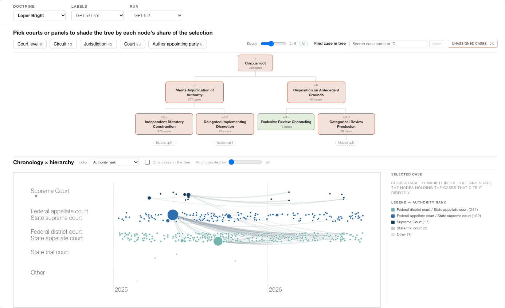

# Auto-Treatise



Code for *Auto-Treatise: Mapping Interpretive Ambiguity in Case Law*.

Given the cases that cite a base case, the pipeline:

1. Fetches the citing opinions from CourtListener.
2. Filters each opinion to the relevant paragraphs.
3. Labels each sentence by role, attribution and stance.
4. Writes an issue brief for each case.
5. Builds a binary tree of interpretive distinctions with an LLM.

## Setup

```bash
conda create -n auto-treatise python=3.10 -y
conda activate auto-treatise
pip install -r requirements.txt
cp .env.example .env    #  edit .env: one KEY=value per line
```

API keys are read from `.env` in the repository root:
- `COURTLISTENER_API_KEY`(https://www.courtlistener.com/profile/api/)
- `OPENAI_API_KEY` 

Run every command from the repository root.

## Running the pipeline

Example: A tree for *Trump v. CASA* (CourtListener cluster 10618550, via `https://www.courtlistener.com/opinion/10618550/trump-v-casa-inc/`). Run from the repository root. Everything is written under `doctrines/casa/`. `RUN` is the name you give the tree run.

```bash
D=casa
RUN=casa_gpt-5.2

# 1. Config: doctrines/casa/config.toml
mkdir -p doctrines/$D
cat > doctrines/$D/config.toml <<'EOF'
[segmentation]
query = "The court considers injunctive or other equitable remedies."
majority_only = true
model = "gpt-5.1"

[tree]
constraint = "Federal courts do not have authority to issue universal or nationwide injunctions."

[split]
file = "data/split_q70.json"
EOF

# 2. Corpus from CourtListener: data/citing_cases.db, data/citing_cases_clean.db
python -m courtlistener.create_dataset --doctrine $D --cluster-id 10618550

# 3. Temporal split: data/split_q70.json
python -m courtlistener.split -d $D -q 0.7

# 4. Relevance filter and sentence attribution (cached in the clean DB)
python -m auto_treatise --stage segment --doctrine $D

# 5. Profiles and tree: analysis/runs/$RUN/corpus_level.json
python -m auto_treatise --stage build --doctrine $D --tree-model gpt-5.2 --run-id $RUN

# 6. Relabel: analysis/runs/$RUN/labels_gpt-5.6-sol.json
python -m auto_treatise.labels --doctrine $D --run-id $RUN

# 7. Judge panels
python -m descriptive_findings.judge_extract --doctrine $D
python -m descriptive_findings.judge_extract --doctrine $D --fill-from-fjc
python -m descriptive_findings.judge_party --doctrine $D --write-db

# 8. Generalization: analysis/runs/$RUN/incremental/, pooled summary in analysis/incremental/$RUN/
python -m generalization --stage all --doctrine $D --run-id $RUN

# 9. Facet and decision-date tests: analysis/runs/$RUN/descriptive_findings/
python -m descriptive_findings --doctrine $D --run $RUN

# 10. Citation graph: analysis/runs/$RUN/citation_graph.json
python -m citations --doctrine $D --run-id $RUN

# 11. View the tree and citation graph in the UI (http://localhost:5173)
cd ui && npm install && npm run dev
```

Pass `--min-citation-depth N` to step 3 to keep only opinions that cite the seed at least N times.
Use `--test` on step 4 or 5 to run only the first 10 train cases. 
Use `--dry-run` to print the calls without making them. 
